# multicam-ground-fusion — one map, many cameras: tracking people across camera views with checks that catch impossible motion

**Status: v0.1, portfolio project.** Homography projection, Kalman fusion, Mahalanobis-gated association and plausibility flags are built and tested, and validated on a **synthetic** multi-camera scene. There is no real detector (YOLO / ByteTrack), no Wildtrack or PETS data, and no bird's-eye-view renderer yet ([Results](#results), [Limitations](#limitations)).

```text
$ python examples/demo.py          # two cameras, two people; one person starts sprinting
4 detections this frame (2 cameras x 2 people), 2 tracks:
  track 0: x= 19.5 y= 10.0 m  speed  1.2 m/s  95% ellipse 0.70 x 0.70 m  flags: none
  track 1: x= 19.8 y= 18.9 m  speed  7.8 m/s  95% ellipse 0.70 x 0.70 m  flags: IMPLAUSIBLE_SPEED
```

*Real output of [examples/demo.py](examples/demo.py): both cameras see both people, and the tracker fuses the four detections into two tracks. The walker moves at 1.2 m/s. The second person is jogging at 1 m/s and then accelerates to 9 m/s; the tracker follows, raises `IMPLAUSIBLE_SPEED` when the speed passes the 8 m/s ceiling used in this demo, and keeps the flag (it is sticky), rather than quietly smoothing the motion away. The demo scenario and noise are synthetic.*

## What is this? (plain-language overview)

A single security camera sees only part of a site, and people disappear behind objects. Put several cameras on the same area and you can follow someone from one view to the next, **if** you can answer two questions: *where on the ground is each person* (not where in the picture), and *is the person camera B sees the same one camera A just saw?*

multicam-ground-fusion answers both for a flat floor or yard:

1. **Project.** A one-time camera calibration (a homography) turns "the bottom-centre of this box in the picture" into "this many metres east and north on the shared ground map". Every camera is mapped onto the same map.
2. **Associate.** For each new detection, the tracker works out how *statistically surprising* it would be for each existing track to have produced it (the Mahalanobis distance, which accounts for each track's uncertainty), and matches detections to tracks optimally (the Hungarian algorithm). A match that is too surprising is **refused**, not forced.
3. **Fuse.** A Kalman filter keeps each track's position, velocity and uncertainty, and updates it with every camera that sees it, so two cameras on one person give one track, not two.
4. **Check plausibility.** If a track's speed rises above a physical ceiling (a person does not move at 40 m/s), it is **flagged** for review, not silently corrected.

**What it is not.** It is not a detector: it starts from bounding boxes that something else (YOLO, a person detector) produced. It does not recognise faces or appearance, so it cannot tell two people apart by how they look, only by where they are and how they move. It assumes a flat ground plane.

### Who it is for, and when it earns its place

| If you are... | the project gives you... |
| --- | --- |
| building multi-camera analytics (site safety, perimeter monitoring, retail flow) | the fusion layer between per-camera detections and a single ground-plane picture |
| working on tracking or sensor fusion | a small, readable reference: projection, gating, assignment and Kalman filtering with tests |
| worried about trusting tracker output | explicit checks: refused associations are counted, impossible speeds are flagged |
| evaluating trackers | a seeded synthetic scene with ground truth and CLEAR-MOT-style metrics (MOTA, MOTP, ID switches) |

It is a poor fit if cameras do not share a ground plane (stairs, multiple floors), if you need appearance-based re-identification, or if you need results validated on real footage today.

### Why gate the association, instead of always taking the best match?

A tracker that always attaches a detection to the nearest track will happily teleport a track onto a different person. Statistical gating says "that detection is too unlikely to belong to this track", so a new track is started instead, and the refusal is counted. The same logic applies to speed: a flag you can see is better than motion that has been quietly smoothed.

**What's real and what's not.** The geometry, filter, gating, assignment and flags are real, tested code. The scene, the detections and every number below are **synthetic**. Real detector noise, calibration error and crowding have not been tested.

## At a glance

| | |
| --- | --- |
| Input | per-camera bounding boxes each time step, and a pixel-to-ground homography per camera |
| Output | confirmed tracks with ground position, speed, covariance (for drawing ellipses) and flags |
| Gate | chi-square at 99%, 2 degrees of freedom on squared Mahalanobis distance |
| Measured (synthetic, 10 held-out seeds) | two cameras: MOTA 0.93-0.96; one camera: 0.61-0.67 (it sees only part of the scene) |
| Stack | NumPy, SciPy only; no detector, no deep learning |
| Tests | 10, including property-based; `mypy --strict`; ruff |

## Architecture at a glance

```mermaid
flowchart LR
    CAMS[/"per-camera detections<br>bounding boxes<br>from any detector"/]
    subgraph proj["1 · Project (deterministic)"]
        direction TB
        BC["bottom-centre pixel<br>of each box"]
        HOM["planar homography<br>pixel to metres on ground"]
        BC --> HOM
    end
    subgraph assoc["2 · Associate, one camera at a time"]
        direction TB
        COST["squared Mahalanobis distance<br>to every track"]
        HUN["Hungarian assignment"]
        GATE{"distance ≤ chi-square 0.99<br>2 degrees of freedom?"}
        COST --> HUN --> GATE
    end
    subgraph fuse["3 · Fuse (Kalman, constant velocity)"]
        direction TB
        UPD["update matched track<br>from every camera that sees it"]
        NEW["spawn tentative track"]
        PRED["predict all tracks forward dt"]
    end
    subgraph life["4 · Track life and plausibility"]
        direction TB
        CONF["confirmed after min_hits<br>deleted after max_misses"]
        FLAG{"speed above<br>physical ceiling?"}
        IMP["flag IMPLAUSIBLE_SPEED<br>never silently corrected"]
    end
    OUT(["confirmed tracks<br>position · speed · covariance ellipse · flags"])
    CAMS --> BC
    HOM --> COST
    PRED --> COST
    GATE -- "yes" --> UPD
    GATE -- "no: refused, counted" --> NEW
    UPD --> CONF
    NEW --> CONF
    CONF --> FLAG
    FLAG -- "yes" --> IMP --> OUT
    FLAG -- "no" --> OUT
    classDef det fill:#e8f1fb,stroke:#2f6db5,color:#102a43
    classDef bad fill:#fde8e8,stroke:#c0392b,color:#4a1010
    classDef ok fill:#e3f5e8,stroke:#2e8b57,color:#0f3b21
    classDef io fill:#f2f2f2,stroke:#666,color:#222
    class BC,HOM,COST,HUN,GATE,UPD,NEW,PRED,CONF,FLAG det
    class IMP bad
    class OUT ok
    class CAMS io
    style proj fill:#f4f8fd,stroke:#2f6db5,color:#102a43
    style assoc fill:#f4f8fd,stroke:#2f6db5,color:#102a43
    style fuse fill:#f4f8fd,stroke:#2f6db5,color:#102a43
    style life fill:#f4f8fd,stroke:#2f6db5,color:#102a43
```



*The detector upstream is the probabilistic part and is outside this repo; everything shown is deterministic, so the same detections always give the same tracks and flags. In the diagram, "any detector" means the detections are treated as untrusted evidence: gated, counted and flagged rather than believed.*

## Quickstart

```bash
git clone https://github.com/PCSchmidt/multicam-ground-fusion && cd multicam-ground-fusion
uv venv && uv pip install -e ".[dev]"

python examples/demo.py              # the output shown above
python scripts/benchmark.py          # synthetic MOTA / ID-switch table (about a minute)
pytest -q                            # 10 passed
```

```python
from multicam_fusion import GroundPlaneTracker, Detection, estimate_homography

H_A = estimate_homography(pixel_points_A, ground_points_A)   # >= 4 surveyed point pairs; DLT
tracker = GroundPlaneTracker({"A": H_A, "B": H_B})
confirmed = tracker.step(dt=0.1, detections=[Detection("A", (x0, y0, x1, y1)), ...])
for t in confirmed:
    t.position, t.speed, t.flags            # t.p[:2, :2] is the position covariance
```

`covariance_ellipse(t.p[:2, :2], 0.95)` returns the semi-axes and angle for drawing a bird's-eye-view ellipse.

## Approach: why it is built this way

- **Detections are evidence, not truth.** Each is gated against what the track predicts; ones that do not fit are counted as refused and start a new track instead.
- **Flag, don't fix.** A physically impossible speed raises a visible flag. Silent smoothing would hide a calibration error or an identity swap.
- **Fuse by sequential update.** Each camera's detections are associated and applied in turn, so a person in the overlap zone updates one track from both views.
- **Small and dependency-light.** NumPy and SciPy only; the Kalman predict, update and gating code is a few dozen lines and can be read in one sitting.
- **Measure the noise model.** The gate is only as good as the assumed measurement noise, and the project's first benchmark showed what happens when that is wrong (see Results).

## Motivation

This is the multi-camera step beyond my [SiteWatch AI](https://github.com/PCSchmidt/sitework-ai) project, which tracks people and vehicles from one camera and converts positions to metres with a homography. Real sites need several cameras, which introduces identity switches and coordinate disagreements. The goal here is the fusion layer with the same philosophy as the rest of the portfolio: the probabilistic detector proposes, deterministic gates decide.

## Method (what the tracker actually does)

1. **Project** (`geometry.py`): the bottom-centre of each box goes through the camera's homography to ground metres. A point that maps to the horizon is rejected.
2. **Predict**: every track moves forward by the time step with a constant-velocity model and process noise from an assumed acceleration (default 1 m/s^2).
3. **Associate, per camera**: build the matrix of squared Mahalanobis distances between every track and every detection from that camera, solve the assignment with the Hungarian algorithm, and accept a pair only if its distance is within the chi-square 99% bound (about 9.21 for two degrees of freedom).
4. **Update or spawn**: matched tracks get a Kalman update; unmatched detections start tentative tracks (this includes detections the gate refused). Cameras are processed one after another within a time step.
5. **Track life**: a track is confirmed after three updates and deleted after five consecutive misses.
6. **Plausibility**: if a track's speed exceeds `v_max_mps` (default 12), `IMPLAUSIBLE_SPEED` is added to its flags and stays.

## Results

Synthetic only: four targets moving in a 40 x 40 m yard for 200 frames at 10 Hz, wall reflections, 3 px pixel noise, per-detection dropout, two cameras with perspective homographies. Camera A sees x from 0 to 26 m and camera B 14 to 40 m, so the overlap is 14 to 26 m. Mean of 10 held-out seeds (100-109) per row; the measurement noise (`meas_sigma_m`) was tuned on dev seeds 0-4 only. Reproduce: `python scripts/benchmark.py`.

| Cameras | Dropout | MOTA | MOTP (m) | ID switches / run | FN / run | FP / run |
| --- | --- | --- | --- | --- | --- | --- |
| A | 0.1 | 0.665 | 0.198 | 1.2 | 262 | 5 |
| A | 0.3 | 0.650 | 0.222 | 1.8 | 270 | 8 |
| A | 0.5 | 0.613 | 0.258 | 5.7 | 298 | 6 |
| A+B | 0.1 | 0.952 | 0.177 | 3.1 | 8 | 28 |
| A+B | 0.3 | 0.960 | 0.190 | 3.6 | 14 | 15 |
| A+B | 0.5 | 0.926 | 0.225 | 5.3 | 41 | 13 |

(800 ground-truth object-frames per run.)

- **Most of the two-camera gain is coverage, not smarter filtering.** Camera A cannot see about 35% of the yard, so roughly 260 of 800 object-frames are structural misses for it. The table does not separate the coverage effect from the fusion effect.
- Fusion in the overlap tightens position error slightly (0.177 vs 0.198 m at dropout 0.1).
- ID switches are a few per run in every setting, and slightly higher with two cameras at low dropout (3.1 vs 1.2); a camera hand-over is a plausible cause, but it was not tested. With 10 seeds, a difference of a few switches is noise.
- **A wrong noise model is expensive.** With the first default (0.3 m) two-camera runs produced about 194 false tracks per run and MOTA 0.72: the real per-axis ground error from 3 px of noise was about 0.33 m, so the gate refused valid detections and spawned duplicates. Raising it to 0.5 fixed it. Full detail: [docs/RESULTS.md](docs/RESULTS.md).

## Limitations

- **Synthetic scene only.** No real detector noise, occlusion, crowding or calibration error; no Wildtrack or PETS 2009.
- **Constant-velocity motion.** Sharp turns and stops are modelled only through process noise.
- **One fixed noise level.** Real ground-plane error grows with distance from the camera; per-detection covariance from the homography's Jacobian is the obvious next step. This is the main risk for real data, as the tuning story above shows.
- **No appearance.** Geometry only, so crossing targets can swap identities.
- **Flat ground plane assumed**, with bottom-centre foot points; occluded feet bias them.
- **Linear measurement, so a plain Kalman filter.** An extended Kalman filter would only be needed to filter in pixel space; not implemented.
- **No real detector, no IDF1, no bird's-eye-view renderer, no drift-detection recall measurement yet.**

## Operational notes

### What runs where

Everything runs locally on a CPU; the benchmark takes about a minute. There is no detector, GPU or network involved.

### Data and keys

No keys and no external data: the scene is generated from a seed. Real footage later should be a public dataset (Wildtrack, PETS 2009) or synthetic.

### Verify the claims (a reviewer's path)

```bash
pytest -q                          # 10 passed, includes a test that two cameras beat one in the overlap scene
mypy src tests scripts             # strict, clean
python examples/demo.py            # the tracks and flags shown at the top
python scripts/benchmark.py        # the table above (10 seeds x 6 settings)
```

### Documentation map

| Doc | What it covers |
| --- | --- |
| [docs/RESULTS.md](docs/RESULTS.md) | protocol, the table, how to read it, the noise-model finding |
| [examples/demo.py](examples/demo.py) | the worked example above |
| [src/multicam_fusion/tracker.py](src/multicam_fusion/tracker.py) | association, Kalman update, track life and flags |

## License

MIT. See [LICENSE](LICENSE).

## Author

Chris Schmidt ([PCSchmidt](https://github.com/PCSchmidt)). Part of a portfolio on evaluator-gated AI systems: probabilistic components propose, deterministic gates decide.
