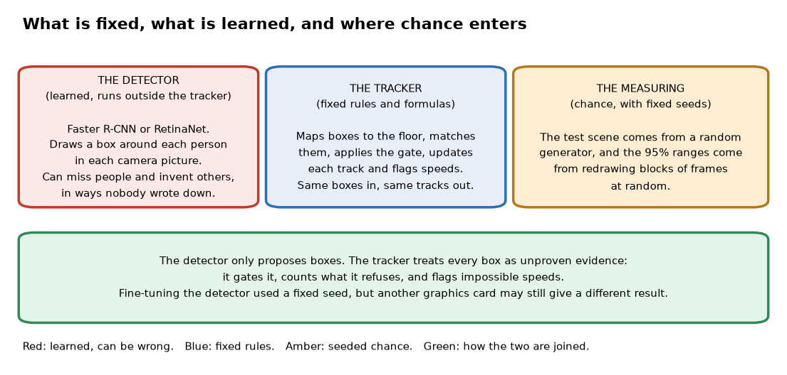
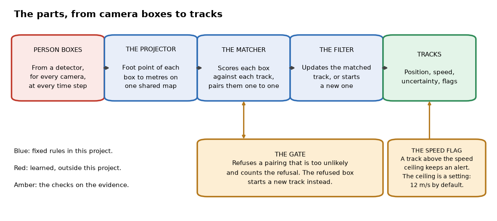
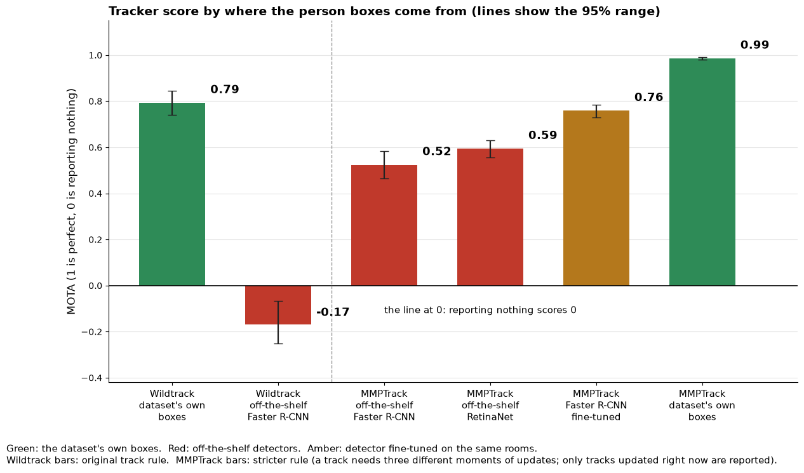

# multicam-ground-fusion

*A program that takes person boxes from several cameras watching the same floor, places each person on one shared map, and follows them over time, with checks that refuse unlikely matches and flag impossible speeds. It comes with measurements on two public real-camera datasets.*

Status: version 0.4, a finished research prototype, built between 9 and 14 October 2026. Code: https://github.com/PCSchmidt/multicam-ground-fusion (under the MIT (Massachusetts Institute of Technology) licence, a permissive open-source licence that lets anyone reuse the code). It is not deployed, and nothing shows that anyone but me has used it.

One security camera sees only part of a site, and people vanish behind objects. Put several cameras on the same floor and you can follow someone from one view to the next, if the program can answer two questions. Where on the ground is each person, rather than where in the picture? And is the person camera B sees the same one camera A saw a moment ago? I built multicam-ground-fusion to answer both for a flat floor or yard, and then to find out how well it does on real footage.

The idea is that a detector proposes and plain code decides. A detector is a trained program that draws a box around every person in a camera picture; it is not part of this project's code. The tracker, which is the project, turns each box into a point on a shared map in metres and matches it to the people it already follows, but only when the match is believable. An unlikely match is refused and counted, and a track whose speed becomes physically impossible is flagged instead of quietly smoothed.

The score I use is MOTA (Multiple Object Tracking Accuracy). Toy example: over 100 person-moments, a tracker misses 10 people, reports 6 people who are not there and swaps 4 identities. That is 20 errors, so the score is 1 minus 20 over 100, or 0.80. A perfect tracker scores 1.0, and one that reports nothing scores 0.0. Errors can outnumber people, so a score can drop below zero, which means it is worse than reporting nothing.

The headline is short. I tested on two public datasets. Wildtrack is a crowded public square filmed by seven cameras. MMPTrack is a set of indoor scenes, a lobby, an office and a retail store, filmed by several cameras. With the datasets' own hand-drawn boxes, the indoor score is 0.99. With an off-the-shelf detector, meaning a published model used as it comes with no further training, it falls to 0.52, and on the square it is minus 0.17. A detector fine-tuned on the same rooms, meaning trained a little further on pictures of them, lifts the indoor score to 0.76. So most of the loss comes from detection, not tracking. All of this rests on one square and three rooms, and I got the data from unofficial copies.

Here is what is fixed and what is learned. A calculator is deterministic: the same input always gives the same answer. A weather forecast is probabilistic: it is a best guess that can be wrong. The tracker is a calculator, with no learned parts. The detectors are the forecast. They learned from example pictures, they miss and invent people in ways nobody wrote down, and their scores are not true probabilities. The tracker therefore treats every box as unproven evidence.

Chance enters in three places: the simulated test scene, the random resampling behind the 95% ranges (a range the true score very likely falls in), and the random batches used to fine-tune a detector. The code sets a fixed seed, a starting number that makes a random draw repeat, for all three. A rerun should repeat them, although a different graphics card might still change the fine-tuned detector, and I have not tested that.

AI coding agents wrote almost all of the code. I directed the scope, plan, architecture and preferences. If you have ten minutes, read the chapters on what it does, the results, and the strengths and shortcomings.

## What problem this solves

Take a warehouse with four cameras. A worker walks toward the shelves. Camera 1 sees her until a pillar hides her, camera 2 picks her up, and camera 3 glimpses her from another angle. Each camera alone produces its own list of boxes. Counting people or checking a speed means merging those lists into one answer. That is hard because the same person sits at different pixel positions in each view, and two different people can look alike to a program that uses only positions. Merging camera views like this is called sensor fusion.

People who build site-safety, perimeter-monitoring or retail-flow tools meet this problem. Without a fusion step they run one camera at a time or write matching rules by hand for each site. The README (the project's front-page description) names four kinds of reader: builders of multi-camera tools, people learning sensor fusion, people who worry about trusting tracker output, and people evaluating trackers. I treat those as intended readers, not proven ones.

The project follows my earlier SiteWatch AI project, which watches one camera and converts picture positions to metres. Several cameras bring new trouble: identity switches, where one person's track jumps to another person, and cameras that disagree. The goal here is only the fusion layer.

It deliberately does less than it could. It is not a detector. It does not recognise faces or clothes, so it tells two people apart only by where they are and how they move. It assumes a flat floor, which rules out stairs. The README lists parts of the original roadmap that were never built, among them a fast detector called YOLO (You Only Look Once), a per-camera tracker, a third dataset and a drift alarm. The results say nothing about those.

It does not compare against a ready-made tracker; it compares versions of itself, and fusion against single cameras.

In short, the project asks how far plain geometry and a standard filter can follow people across cameras, and the measurements suggest the limit lies mostly in the detector.

## What it does, step by step

At each moment the input is a set of boxes from each camera, plus a calibration for each camera: a one-time recipe for turning picture positions into floor positions. The output is a list of confirmed tracks, each with a ground position in metres, a speed, an uncertainty shape (an oval around the position showing how sure the tracker is) and any flags.

An everyday comparison is a team of lifeguards on a pool deck, each watching one section and calling swimmers' positions to a coordinator who holds one map. If a call is far from where any pin could have moved to, the coordinator does not drag a pin across the pool. They add a new pin and note the odd call. The comparison breaks down because a coordinator can see the swimmers, while the tracker sees only the calls.

The project ships a demo. Two cameras watch two people. One walks at 1.2 metres per second. The other jogs at 1 and then accelerates to 9. The tracker fuses the four boxes at each step into two tracks. The printed result shows the walker with no flags. The other person shows 7.8 metres per second and the alert IMPLAUSIBLE_SPEED. The speed ceiling is a setting. The tracker's default is 12 metres per second, but the demo lowers it to 8 so that the alert fires in a short run. The demo's output matches the README, and its scene and noise are generated by the program, so it is a staged example.

No person sits in the chain. The intended reader of the output is an analyst, and any regulated use would need approved camera data, access control and an audit trail, none of which exists here.

In short, boxes from many cameras go in, and one map of followed people comes out, with refusals counted and impossible speeds flagged.

## The parts, the data and the tools

There are four working parts, named here by their jobs. The projector takes the bottom-centre of each box, which approximates where the person's feet touch the floor, and converts it to metres. The matcher scores every box against every track already followed and pairs them one to one. The filter updates each paired track with its new position, or starts a new track for a box nobody claimed. The housekeeper confirms a track once it has enough updates, deletes it after five missed steps in a row, and raises the speed flag.

Three rules should never break. A box may join a track only if it passes the gate, the believability cut-off explained in the next chapter. A flag is never removed or corrected silently. And a point that maps to the horizon raises an error. The code enforces all three, and tests cover them. That error stops the whole step, so one bad box can halt a run; the project does not skip such a box.

There are two kinds of data. The first is a seeded simulated yard: four people, two cameras with overlapping views, and noise I chose. The second is the two public datasets. Wildtrack has ground-truth person positions at 2 frames per second, and its test half has 4,733 person-frames, where a person-frame is one person at one moment. The MMPTrack study used about 5 frames per second of three indoor scenes with about seven people at a time.

Both copies came from unofficial online mirrors because the official host could not be reached, so they cannot be checked against the originals, and the MMPTrack calibration conventions had to be inferred. No licence file was found for either, so nothing from them is committed to the repository.

The tracker uses Python with NumPy and SciPy, two libraries of numerical routines. The detectors use PyTorch, a library for running and training neural networks. All of it runs on one laptop.

In short, four small fixed parts turn boxes into tracks, and everything that learned from pictures sits outside them.

## The methods that make it work

Each method below is standard and short. Here is the idea of each, with the weakness that matters.

**Turning a picture point into a floor point.** A homography maps a flat surface seen from one viewpoint to another. Toy example: if a 100 by 100 pixel square in the picture is a 2 by 2 metre square on the floor, the pixel (50, 50) is the floor point (1, 1). For the real datasets the calibration was supplied, and on Wildtrack the projected hand-drawn boxes landed a median 0.07 to 0.13 metres from the labelled positions. The flat floor and visible feet are assumptions, and a box that cuts off the feet moves the point.

**Judging whether a box fits a track.** The tracker keeps a best guess of each person's position and how uncertain it is. A box that lands far from the guess, measured in units of that uncertainty, is refused; this cut-off is the gate. It is set so that, if the noise assumption holds, a correct match fails it about once in a hundred. Toy example: a box 1.5 uncertainty units away passes, and one 3.3 units away is refused and starts a new track. The weakness is the assumed noise: real error grows with distance from the camera, and the tracker uses one fixed value.

**Pairing boxes with tracks.** The Hungarian algorithm finds the pairing with the lowest total cost, using each track and box at most once. Taking the best-looking pair first can go wrong. Toy example: two tracks and two boxes with costs 1 and 2 for the first track and 2 and 10 for the second. Taking the cost-1 pair leaves the cost-10 pair, a total of 11. The best pairing costs 2 plus 2, a total of 4.

**Updating a track.** A Kalman filter blends a prediction with a new measurement, trusting each by how reliable it is. It assumes a person moves at constant speed between steps. Toy example in one dimension: the prediction is 10.0 metres and a measurement says 10.9, and the filter, trusting the measurement a bit more than half, lands near 10.5 and is more certain than either. Two cameras seeing one person apply this twice.

**Scoring and ranges.** MOTA was explained in the opening. IDF1 (Identification F1 score) measures how well each person keeps one identity over time. A track counts as matched when it is within 0.5 metres of the person. Each real-data score has a 95% range from a block bootstrap: resample stretches of consecutive frames at random, thousands of times, and take the middle 95% of the scores. Wildtrack has only ten, so its ranges are rough.

In short, each method is standard, and each has the weakness that matters: one fixed noise value and a flat floor.

## The detectors and why they matter

The project uses three detectors, none trained from scratch. All come from torchvision, a library of ready-made vision models, and start from weights trained on COCO (Common Objects in Context), a large public collection of labelled everyday pictures. Only the person class is used. Each model returns boxes with scores from 0 to 1. A score is not a probability, so the study keeps boxes above a cut-off chosen on development data, meaning frames used for tuning and kept separate from the test frames scored once at the end.

Two are standard off-the-shelf detectors. Faster R-CNN (Region-based Convolutional Neural Network) is the main one: it first proposes regions that may hold an object, then refines each box. RetinaNet scores a dense grid of candidate boxes in one pass. The third is Faster R-CNN fine-tuned on person boxes from the three MMPTrack rooms: two passes over the data with a fixed recipe written in advance. It was tested on a different recording session of the same rooms and cameras, so it measures how well a detector adapts to a site, not how well it carries over to a new one.

YOLO, the detector named on the original roadmap, was not tried. The off-the-shelf detector's recall, the share of real people it finds, ranged from 0.15 to 0.67 across cameras and rooms. The safeguards are the gate, the refusal count and the score cut-off; no human reviews the output.

In short, the detectors are borrowed and they set the ceiling, and the project's contribution is measuring how much each one costs.

## Edge cases, tests and safeguards

Twenty-two tests pass, matching the README. They cover the mapping and its round trip, one person in two cameras giving one track, a far-away box being refused, a track deleted after misses, a flag that stays on, and random inputs that check the uncertainty stays valid. Automatic checks run the tests and a type checker (a tool that catches mismatched kinds of data) on every push.

Checks written for this guide tried bad inputs on the tracker, in a scratch copy. A box far from every track is refused and counted. One person seen by two cameras gives one track. A foot point at the horizon stops the whole step with an error, which is handled but harsh. Three cases are not handled: four calibration points in a line give a nonsense mapping with no error, two identical boxes from one camera produce a duplicate track that is later confirmed, and a camera name missing from the calibration crashes the run. None of the probes broke the rule that flags are never removed. There is no saved state, so a crash means starting over.

Evidence that it works on new data comes from the studies. Each had a written plan with predictions, tuning on development data, and one run on the test data, and the commit order shows each plan was committed before its results. Push times were not available, so an outsider cannot prove the order beyond that. Package versions are not locked, so a fresh install could give different numbers.

In short, the tracker's core is tested, while the parts that touch real data and detectors are checked only by the studies themselves.

## Does it work? The results

**The simulated scene.** Two cameras score 0.93 to 0.96 and one camera 0.61 to 0.67 over ten seeds. One camera cannot see about a third of the yard, so most of the gap is coverage, not smarter filtering. This test predicted none of what followed on real footage.

**The square, with hand-drawn boxes.** The tracker scores 0.79 (range 0.74 to 0.84), against 0.58 for the median single camera. About 740 errors were false tracks that kept being reported after a person was lost. Reporting only tracks updated in the current moment lifted the score to 0.92, but I chose that option after seeing development results, so it is exploratory. Removing the gate cost 0.11 and nearly tripled identity switches, from 145 to 393.

**The square, with a real detector.** The score is minus 0.17 (range minus 0.25 to minus 0.07): 4,555 false tracks and 723 misses on 4,733 person-frames, so 5,535 errors in all, counting 257 swaps. The best single camera scored 0.24, so fusion lost. The tracker starts a track from any box nobody claims, so detector errors from seven cameras add up. The speed flag, at its default of 12 metres per second, never fired, because at two frames per second a person moves under a metre per step. An exploratory ceiling of 4 metres per second caught only 23 to 34% of identity switches.

**The indoor rooms.** Before this study I designed a stricter rule on Wildtrack development frames. The original rule let a track count after three updates, even if all three came from different cameras in one moment, and kept reporting it for up to five moments after it was last seen. The stricter rule needs updates in three different moments and reports only tracks updated right now. With the hand-drawn boxes the tracker scored 0.996, with seven identity switches in 41,632 person-frames, so most of Wildtrack's lower score came from crowding and the low frame rate. With the off-the-shelf detector the stricter rule helped by only 0.02, where I had predicted 0.3.

The picture shows the results. Wildtrack bars use the original rule and indoor bars the stricter one.

Fine-tuning improved the score by 0.235 (range 0.164 to 0.304) over the same detector off the shelf, and RetinaNet by 0.07. Five of seven written predictions held, including both of those gains. Two did not. Fusion beat the best single camera in only one of three rooms, because in the lobby one camera scored 0.97 alone. And a rule that asks several cameras to agree still helped by 0.02, where I expected nothing. The fine-tuned detector's remaining problem is about 8,900 false tracks, not misses.

In this study the plans came first and tuning used separate frames. Its limits: three rooms is a small sample, scores differ by up to 0.4 between rooms, and two cut-offs sat at the edge of the tested grid, so better values may exist. The numbers in the README match the saved result files.

In short, on this small sample the detector accounted for most of the loss, and fusion helped when the detector was weak but not consistently, so I would not generalise beyond these datasets.

## Could it be put into real use?

It has never run outside my machine, and no one else has used it. It contains no model that a person would use directly. It is a measurement of a design, not a service. On the ladder from experiment to works locally to deployable to operated, it sits at works locally.

Someone else can run the tests from a clean start, though the real-data studies need a 6.8 gigabyte download and a graphics card. Automatic checks run the tests, but no evaluation can fail the build. Output quality is measured against baselines. Safe behaviour is partial: refusals and flags exist, but one bad box can stop a step. Versions are not locked, and logging is only the counts the studies print.

What mirrors real practice is the discipline of written predictions and one-shot test runs. The gap to deployable is large: a service wrapper, a live video feed, per-site calibration, monitoring and a plan for retraining the detector. Three steps would help most: make the automatic checks fail if the simulated benchmark drops, log refused matches and flags, and write a one-page runbook (a step-by-step guide) for calibrating a new site.

In short, this works locally, with an evaluation on small data and no operating history.

## Strengths, shortcomings and the work left

The strengths are that the tracker is small and readable, its checks refuse and flag instead of quietly fixing, and the studies state predictions in advance and report the ones that failed.

Three shortcomings matter. First, one fixed noise value is used for every box, though real error grows with distance from the camera. The README names the fix, computing each box's uncertainty from the mapping, which is a medium-sized change with probably high payoff. Second, there is no appearance information, so people who cross paths can swap identities. Adding it means adding another learned model, which breaks the tracker's all-fixed design, so I would leave it and say so. Third, the speed flag is close to useless at low frame rates, as the results showed. A flag based on how far a position jumps relative to its uncertainty is the obvious replacement.

The tracker, the studies, the demo and the tests are done. The bird's-eye drawing, the drift alarm, YOLO with a per-camera tracker, a more elaborate filter and a third dataset were planned and not built, and the README says so. The project's own question is answered, so it could be left as it is. If reopened, the first milestone would be per-box uncertainty, judged by whether it lifts the off-the-shelf detector's score on the Wildtrack development frames before touching the test frames.

Running costs nothing for the tests and several hours of graphics-card time for the detector studies. Security risk is small: no keys, no network service and no committed data.

In short, the project is complete for its question, and its main weaknesses are named in its own README.

## How it was built

AI coding agents wrote almost all of the code, and I directed it. My part, from the project's documents, was the scope, the study plans and the predictions in them, which are written in my name. 
In short, I set the question and the standard, and agents wrote the code that answered it.

## For recruiters and interviewers

In thirty seconds: I directed AI coding agents to build a tracker that places people from several cameras on one map, refuses unlikely matches and flags impossible speeds, and I measured it on two public real datasets. On this small sample the detector, not the tracker, limits the score. Nobody but me has used it.

| Typical requirement | What the project shows | Strength |
| --- | --- | --- |
| Evaluation and metrics | Written predictions, one-shot runs, ranges, baselines | Shown |
| Reporting results plainly | Negative results kept; wrong predictions listed | Shown |
| Model choice and trade-offs | Three detectors compared, including fine-tuning | Partly |
| Deployment and monitoring | None | Not shown |
| Agentic workflows, prompts, human review | None | Not shown |

It fits an applied computer-vision or machine-learning engineer role best and agentic-workflow or forward-deployed work weakly. It does not show operating anything for users, working on a team, or scale.

Likely questions, briefly. The hardest problem was a result that contradicted my plan: the stricter rule I expected to be worth 0.3 gave 0.02, and the later study pointed at the detector. A weak spot was that the simulated results did not predict the real-footage scores. The numbers match the saved result files and the plans were committed first, with the caveats above. I would change the noise model so it varies with distance. For production I would add a live feed, per-site calibration and monitoring, none of which exists.

Skeptical questions. Is this a wrapper around an AI service? No; the tracker is plain code with no model in it. Have I run it for real users? No. What about malicious input? A crafted box could crash a step or create duplicate tracks, and there is no defence.

It should not be exaggerated: it is not a product, it has tracked no one outside two public datasets, and fusion does not always beat the best camera.

In short, this is a small, measured, unoperated project, and what it shows is evaluation discipline, not deployment.

## Glossary

- **Homography:** a mapping between a flat surface seen from two viewpoints.
- **Calibration:** a one-time recipe that turns a camera's picture positions into floor positions.
- **Sensor fusion:** combining readings from several sensors, here cameras, into one answer.
- **Detector:** a trained program that draws a box around each person in a picture.
- **Off-the-shelf:** a published model used as it comes, with no further training.
- **Fine-tuning:** continuing to train a model on new examples, here pictures of the same rooms.
- **Tracker:** the project's code that follows people from step to step on the map.
- **Track:** one followed person, with position, speed and flags.
- **Gate:** a cut-off that refuses a match that is too unlikely.
- **Identity switch:** a track jumping from one person to another.
- **MOTA:** a tracking score where 1 is perfect and 0 is reporting nothing; it can go negative.
- **IDF1:** a score for how well each person keeps one identity over time.
- **Person-frame:** one person at one moment.
- **Recall:** the share of real people a detector finds.
- **Threshold (cut-off):** the score above which a detector box is kept.
- **Development and test data:** frames used for tuning, and frames kept aside and scored once.
- **Seed:** a starting number that makes a random process repeat.
- **Bootstrap:** resampling data many times to see how much a score could vary.
- **95% range:** an interval the true score very likely falls in.
- **Deterministic and probabilistic:** always the same answer for the same input, versus a best guess that can be wrong.
- **Kalman filter, Hungarian algorithm:** a method that blends a prediction with a measurement, and one that finds the cheapest one-to-one pairing.

## Where to look in the code

The main code is in the source folder (geometry, tracker, scoring, simulator and two dataset readers), tests are in the tests folder, the studies' scripts are in the scripts folder, plans and results are in the docs folder, and saved result files are in the results folder. Start with the demo in the examples folder. The core is the tracker file, about 145 lines. Reading order: the demo, the geometry file, the tracker file, the scoring file, then the results documents.

Not run: the real-data scripts, since they need large downloads and a graphics card.
